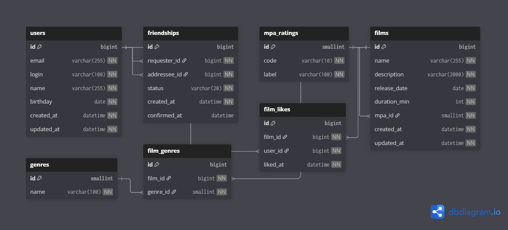

# 🎬 Filmorate

REST-сервис для работы с фильмами и пользователями: лайки, дружеские связи, жанры и возрастные рейтинги, подсчёт популярных фильмов.

> Проект курса «Java-разработчик» Яндекс.Практикума.

## Стек


## Возможности

- CRUD для фильмов и пользователей с валидацией входных данных
- Лайки фильмов и вывод топа популярных
- Дружеские связи с заявками (статусы `PENDING` / `CONFIRMED`)
- Справочники жанров и возрастных рейтингов MPA (`G`, `PG`, `PG-13`, `R`, `NC-17`)
- Связь «фильм ↔ жанр» (многие-ко-многим)

## Архитектура

Слои `controller → service → storage`: хранилища реализованы в двух вариантах (in-memory и на `JdbcTemplate`), доступ к БД через `RowMapper`-ы. Схема БД описана в SQL-скриптах:

- [`src/main/resources/schema.sql`](src/main/resources/schema.sql) — таблицы, ключи, индексы, ограничения
- [`src/main/resources/data.sql`](src/main/resources/data.sql) — тестовые данные справочников

### ER-диаграмма



Основные сущности: `users`, `films`, `friendships`, `film_likes`, `film_genres`, `genres`, `mpa_ratings`.

## Запуск

```bash
mvn spring-boot:run
# API: http://localhost:8080
```

## Тесты

- Юнит-тесты контроллеров и валидации
- Интеграционные тесты хранилищ и контроллеров (`@SpringBootTest`)

```bash
mvn test
```

## CI

На pull request запускается reusable workflow с API-тестами (Postman-коллекции через Newman) и проверкой Checkstyle.
